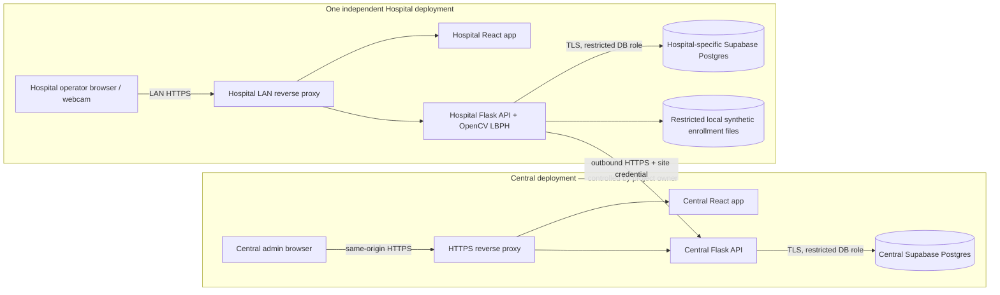
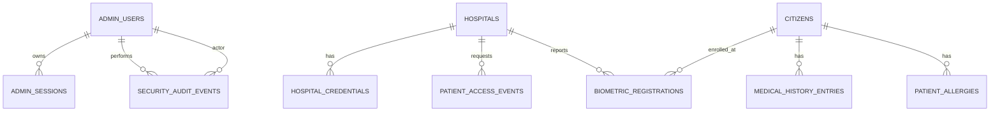
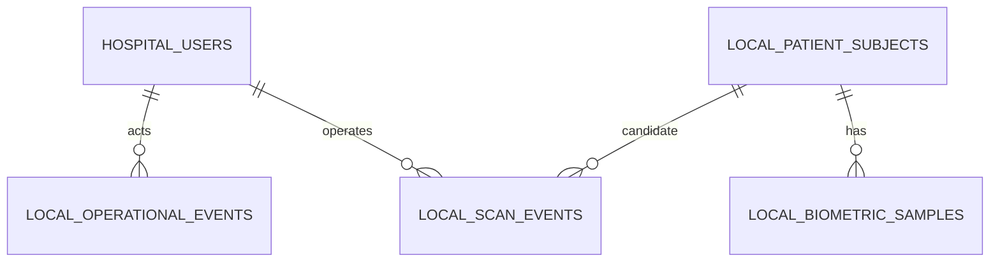

# PROJECT_MASTER_PLAN.md

**Project:** Biometric Emergency Patient Identification System
**Document status:** Approved by the project owner on 2026-10-12; development implementation and migrations completed, hosted app deployment not started
**Planning date:** 2026-10-12
**Implementation status:** Two React + Flask apps are implemented; initial migrations are applied and verified in dedicated Central/Hospital Supabase development projects. No production migration, hosted runtime credentials, or app deployment has been created.

> This is a university prototype for synthetic or otherwise specifically authorized test data. It is not a clinical system, a source of verified identity, or a substitute for clinical judgment. A face match is only a candidate. Blood type displayed from a record is not a transfusion instruction and must never replace laboratory typing and crossmatching.

## 1. Executive summary

The proposal is two independently deployable React and Flask applications with separate PostgreSQL/Supabase projects. The Central System is the authoritative prototype registry and administrator console. A Hospital System performs local webcam capture and OpenCV-based candidate matching, keeps its own operational records and face-training material, and requests patient information only from the Central Flask API over HTTPS. Neither browser nor hospital connects to the Central database.

For the first demonstrable MVP, use one Central deployment and one Hospital deployment, both populated only with synthetic records and authorized test images. Each hospital deployment has a distinct Central-issued credential and a separate local database. A second simulated hospital can be added as a separate installation with its own configuration and database; it must not share another hospital's credentials or local biometric corpus.

Use a narrowly scoped, revocable, high-entropy hospital bearer credential over TLS for the prototype's machine-to-machine API. Store only a verifier/hash at the Central System, issue a replacement on rotation, and never trust a hospital ID supplied by the browser or request body. The Central API derives the hospital identity from the credential. For administrators and hospital operators, use backend-managed accounts with Argon2id password hashes, server-side sessions, secure cookies, CSRF protection, and explicit roles.

OpenCV LBPH is retained as an educational demonstration algorithm, not as evidence of production-grade accuracy. Recognition runs in the Hospital backend. A passing threshold produces a **candidate match** for operator verification, never an automatic confirmed identity. No face image or biometric template is sent to the Central API. Poor input, multiple faces, unknown faces, low confidence, or camera/model failure lead to a clear fallback or no-match state.

## 2. Context reviewed and critical unknowns

### 2.1 Available project context

- The task workspace was checked at `/home/ubuntu`; no application repository, README, SQL migration, or existing project source was found there. The attached `pasted_content.txt` is the project brief, not an existing codebase.
- No project-shared files were present in the project-file directory at the time of review.
- The session configuration lists a Supabase API connector as enabled and a separate Supabase connector as disabled. No dedicated Supabase project-provisioning MCP tool was exposed in the available tool search. Connector metadata alone does not establish what project a credential targets, whether it can create projects, or whether access is authorized for this project.
- Supabase environment-variable capability is available in this session, but no credential value was displayed or tested, and no target project was verified. Do not assume these values point to either of the two intended projects.
- No repositories, database projects, deployment accounts, domains, or real patient data were inspected or changed.
- This document is saved at the current workspace root because no repository root existed. After approval, the repository root and Git remote should be selected before implementation begins.

### 2.2 Critical unknowns and working assumptions

| Unknown | Planning assumption | Why it matters / what must be confirmed |
|---|---|---|
| Jurisdiction and National ID format | Treat the identifier as an opaque, jurisdiction-configurable string. Use synthetic examples only. | Exact syntax, data protection obligations, consent, retention and access rights depend on jurisdiction. A valid ID string is not proof of identity. |
| Real data use | Prohibited for this prototype unless there is a separate, documented authorization and privacy review. | Real health and biometric data substantially changes the risk and compliance profile. |
| Number of hospital installations | One Hospital System installation in the MVP; support independent additional installations by configuration and separate databases. | One isolated database per site increases provisioning and operating work. Confirm whether the demonstration needs one or multiple complete installations. |
| Face dataset and enrollment authority | Use synthetic or explicitly authorized test images; enroll locally at the hospital. No central raw face-image store. | The source, permission, size and diversity of images determine model behavior and whether testing is meaningful. |
| Recognition response | A model result is a candidate; a staff member must verify before relying on it. | LBPH is sensitive to training and capture conditions and can misidentify people. Confirm the intended human-verification interaction. |
| Hosting preference | Compare both requested choices; recommend a self-managed, small VPS for the Central app if hands-on administration is a priority, with managed Supabase databases. | VPS hosting offers control but transfers patching, monitoring, firewall, restore and incident duties to the owner. Managed app hosting reduces operations but offers less direct control. |
| Supabase projects and access | Plan for two logical Supabase projects for the first Central + Hospital pair. Project creation and use of credentials remain blocked pending approval and account/access verification. | The current connector state does not prove project provisioning access or identify target projects. |
| Admin/operator account model | A small number of named accounts with role-based access; no public sign-up or shared default password. | A recovery/contact and account bootstrap procedure must be agreed before deployment. |
| Retention | Provisional synthetic-demo defaults: delete face enrollment files when no longer needed and no later than project close; retain detailed operational logs for 90 days, then delete or aggregate. | These are proposed defaults, not legal retention rules. Confirm retention before deployment; do not apply to real records without a policy review. |
| Recovery expectations | Small prototype, documented encrypted backups and a tested restore before demo release; no production availability commitment. | Required recovery-point and recovery-time objectives depend on hosting and demonstration needs. |

## 3. Problem, objectives, scope and users

### 3.1 Problem and objectives

An emergency department may encounter a person who cannot reliably provide identity information. This prototype demonstrates a controlled workflow that can return a limited, recorded patient profile to an authorized hospital from a centrally administered synthetic registry. A local face-recognition experiment can suggest a candidate, while a manual National ID path provides a separate lookup method.

Objectives:

1. Demonstrate a Central administrator's ability to manage synthetic citizens, medical-history entries, hospitals, credentials and request/audit logs.
2. Demonstrate an independently deployable Hospital System that can capture an image, handle recognition outcomes safely, and request only the record needed from the Central API.
3. Show authentication, per-hospital identity, backend validation, authorization, structured logs, outage handling and tests at the system boundary.
4. Explain limitations, deployment, operations and security decisions in a way that supports university learning.

### 3.2 Roles

| Role | System | Allowed actions |
|---|---|---|
| Central administrator | Central | Sign in; manage citizens and medical-history records; register, disable and rotate hospital credentials; view/filter operational and security logs; export approved redacted operational data. No anonymous sign-up. |
| Hospital operator | Hospital | Sign in locally; capture a probe; see a candidate/no-match/error; confirm or reject a candidate; perform a manual lookup; view local scan history and the limited returned patient record. |
| Hospital administrator | Hospital | Manage local operator accounts and local settings; enroll or retrain authorized synthetic local face samples; test Central connectivity. Cannot administer another hospital. |
| Hospital service identity | Hospital-to-Central API | Look up a patient and, if explicitly granted, verify a synthetic enrollment reference. Identity is derived from the credential, not a caller-supplied hospital ID. |
| Test runner | CI/test environment | Use isolated synthetic fixtures and test credentials. Must not access production data. |

### 3.3 MVP scope

- Central React admin interface and Flask REST API.
- Central admin authentication, protected routes and server-side authorization.
- Synthetic citizen records, structured allergies/blood type and limited medical-history entries.
- Hospital registration, active/disabled state, scoped credential issue/rotation/revocation and connectivity status.
- Central access logs and security audit events with filters, pagination and redaction.
- Hospital React interface, local operator authentication and Flask API.
- Browser webcam capture; backend image checks, face detection and LBPH candidate comparison against a small local test corpus.
- A clear no-face, multiple-face, poor-quality, no-match, low-confidence, candidate, central-unavailable and rejected-request outcome.
- Manual National ID lookup in the request body, never in a URL. Central database equality lookup uses a keyed fingerprint, while the stored identifier is encrypted at application level.
- Minimized result display, visibly marked record freshness/source and blood-type/allergy warnings.
- Local scan/request status log that stores no probe image, token, raw National ID or complete returned medical history.
- Separate Central and Hospital Supabase/PostgreSQL projects for the first demonstration pair; SQL migrations and synthetic seed fixtures.
- Unit, API, database-policy, frontend and critical end-to-end tests; CI lint/security/dependency checks.
- Deployment, operation, backup/restore, test and authorized security-testing documentation.

### 3.4 Future enhancements

- Additional independent hospital sites, each with its own configuration, credential, local database and local biometric enrollment data.
- Stronger hospital identity such as mTLS or a managed OAuth2 client-credentials issuer, key vault integration, per-site network allowlists and automated credential rotation.
- MFA and delegated Central administrator roles; advanced review and approval workflow.
- External append-only/WORM audit export and independently monitored alerting.
- Automated privacy-preserving model evaluation, controlled retraining/version approval and governance procedures.
- Formal operational security review, independent penetration test and legal/privacy/clinical governance review before any real-data evaluation.
- Optional alternative recognition model only after a separate performance and bias evaluation and explicit approval.

### 3.5 Out of scope

- Production clinical use, real patient or government registry integration, clinical diagnosis, treatment recommendations, autonomous triage, transfusion decisions, or any claim of regulatory compliance.
- Real biometric enrollment, real hospital rollout, interoperability with clinical record systems, payment/billing, public patient accounts or cross-hospital biometric sharing.
- Using a National ID as authentication, proof of identity, consent or a biometric-training authorization.
- Storing probe images in central access logs, sending face crops/templates to Central, or exposing either database to a browser or hospital.
- Publicly exposing Flask's development server, opening inbound connections to hospital networks, or creating paid cloud resources without explicit approval.
- Unbounded denial-of-service testing, tests against third-party/public systems, real government databases or real hospital systems.

## 4. Success criteria

The MVP is acceptable when all criteria below are demonstrated in an isolated environment with synthetic data:

1. Both applications run independently; each React client calls only its own Flask API.
2. The Hospital backend makes Central requests over HTTPS only. No hospital or browser receives database credentials or connects directly to Central Postgres/Supabase.
3. Central derives hospital identity from a valid active credential. Missing, invalid, revoked and insufficient-scope credentials cannot retrieve patient data.
4. A successful authorized lookup returns only the allowlisted patient fields and creates an access event. A no-match, denial, validation failure, timeout and service error are distinguishable in logs without storing raw IDs or secrets.
5. Central operators can create/search citizens, manage synthetic history, register/disable hospitals, rotate/revoke credentials, and filter/paginate logs.
6. Face handling exercises each defined outcome. No result is described as confirmed solely because of LBPH. Manual fallback is available when recognition fails.
7. Blood type and allergies are prominent and qualified as recorded information; the UI states that records may be missing or stale and are not a substitute for laboratory verification.
8. Backend validation and authorization tests pass; RLS/grant tests show public roles cannot read/write protected records.
9. Critical login, lookup, denial, revocation, outage, audit and fallback end-to-end journeys pass on a test environment.
10. Deployment and recovery procedures are documented and a synthetic-data backup restore is exercised before a release candidate. Actual results will be recorded only after tests run.

## 5. System architecture

### 5.1 Components and trust boundaries

- **Central browser boundary:** Administrator browser talks to the Central reverse proxy/API. It never talks directly to Supabase/Postgres.
- **Central application boundary:** Central React assets and Flask API run under the Central origin. Flask validates administrator sessions and role on every sensitive endpoint.
- **Central data boundary:** Central Flask connects to Central Supabase Postgres using a dedicated server-only database role over TLS. Migrations use a separate privileged migration path. Database connection secrets stay in Central server configuration.
- **Hospital LAN boundary:** Staff browser talks to its Hospital reverse proxy/API. Webcam frames are sent to the local Hospital backend for in-memory processing and are not sent to Central.
- **Inter-system boundary:** Hospital Flask initiates outbound HTTPS requests to the Central API using its site credential. No inbound connection to the Hospital System is required.
- **Hospital data boundary:** Hospital Flask connects only to that installation's Hospital Supabase/Postgres database. Its local staff sessions, biometric sample files and logs are site-scoped.

### 5.2 Component diagram



### 5.3 End-to-end request lifecycle

1. A staff member signs in to the local Hospital app. The Hospital backend checks the local password hash and issues a short-lived, opaque server-side session cookie.
2. The browser captures a single frame. It posts the frame to the Hospital API over the hospital's LAN HTTPS origin. The API enforces byte and pixel limits, decodes the actual image, checks for zero/one/multiple faces and quality, and processes it in memory.
3. The local OpenCV recognizer compares the face to that hospital's local LBPH model. Its distance/score is interpreted according to the locally calibrated threshold. Low confidence or an unusable frame produces a no-match/error, not an inferred identity.
4. A result above the candidate threshold shows **Candidate — verify before use** with an explicit confirm/reject action. The face score is not accepted by Central as proof and is not used to bypass the Hospital credential's lookup scope.
5. After operator confirmation, the Hospital backend sends a minimal JSON request to Central over HTTPS. A face-candidate lookup sends a Central citizen UUID; a manual lookup sends the National ID in the JSON body. The Hospital ID is not accepted from the UI as authentication.
6. Central authenticates the credential, derives the hospital identity, checks active status, scope, rate limit, schema and request size, and applies the endpoint's authorization. It performs an exact lookup, creates an access event with a correlation ID and redacted identifier fingerprint, and returns only the approved patient fields.
7. The Hospital backend validates the Central response, writes a local outcome/status record, and returns a minimized view to the browser. It does not persist the National ID, response token, probe frame or a copy of the complete central history.
8. If Central times out, is unavailable or rejects the credential, the Hospital records the correct local error status, displays that identity data could not be retrieved, and does not present the incident as a patient-not-found result. Retry is explicit and bounded.

### 5.4 Availability and failure semantics

- Central timeout and 5xx errors are **unavailable**, not a no-match.
- Lookup failure is not cached as a negative identity result. A brief circuit breaker prevents repeated calls during an outage; a staff-initiated retry is available.
- Network requests use bounded connect/read timeouts, request correlation IDs, and at most a limited retry for safe idempotent operations. Do not automatically replay a POST that may have been processed unless it includes a supported idempotency key.
- Local face processing can state that it produced a candidate, but no Central identity/medical information is shown until Central authorizes and returns it.
- Health checks expose only availability and version, never keys, connection strings, patient details or stack traces.

## 6. Technology choices

| Technology | Purpose and fit | Limitations / setup |
|---|---|---|
| React + TypeScript + Vite | Separate responsive Central and Hospital single-page applications with type-checked components and modern browser webcam APIs. | Two independent builds and API bases. Avoid putting secrets or privileged data access in client code. |
| React Router | Protected admin/operator navigation and route-level layouts. | Route guards improve UX only; the Flask backend remains the authorization authority. |
| Material UI (MUI) with project design tokens | Reusable accessible forms, dialogs, tables, alerts and status displays without inventing a component system. | Theme and contrast must be checked; do not use color alone to convey emergency warnings. |
| Dedicated typed API client (`fetch`) | Centralized auth/session handling, JSON/error parsing, timeouts, request IDs and consistent UI errors. | Must not silently retry sensitive lookup requests. |
| Python 3.11+ and Flask | Requested, familiar backend framework; blueprints keep auth, patient, hospital, audit and health APIs separate. | Flask is unopinionated; establish app factory, configuration, extension lifecycle and request limits explicitly. |
| Flask-Smorest + Marshmallow | Request/response schema validation and generated OpenAPI documentation with a Flask-oriented API structure. | Every endpoint still needs explicit authorization; generated documentation is not a security control. |
| SQLAlchemy 2.x + Alembic | Typed Postgres access and versioned reversible database migrations. | Schema migrations require a separate privileged deployment step; migrations are reviewed and tested before production use. |
| PostgreSQL on two separate Supabase projects | Central and Hospital data separation, relational constraints, indexes and familiar university-friendly dashboard tooling. | Two-project setup, separate credentials, plan/backup limits and project creation access must be verified. Each additional hospital requires its own isolated project/database under the strict site-isolation assumption. |
| OpenCV `opencv-contrib-python-headless` | Backend face detection and LBPH recognizer. `face` algorithms are in the OpenCV contrib face module; pin and verify the selected Python wheel/build in CI. | LBPH is sensitive to lighting, pose, occlusion and training coverage; its distance is not a calibrated probability. It is for an educational demonstration only. |
| Pytest | Flask service, repository, validation, permission and integration tests. | Use isolated test database/schema and synthetic fixtures; no destructive tests against production. |
| Vitest + React Testing Library | Frontend component and user-interaction tests. | Does not establish real browser/camera behavior or end-to-end security. |
| Playwright | Browser-level smoke and critical workflow tests across both applications. | E2E credentials and test databases must be isolated and disposable. |
| Supabase CLI / pgTAP where available | Versioned local database testing and SQL-level grant/RLS allow/deny tests. | CLI/pgTAP support and project access must be verified after approval; no cloud mutation is part of this plan. |
| Bandit, pip-audit, `ruff` | Python security linting, dependency vulnerability check and formatting/lint. | Automated reports need triage; a clean scan is not proof of security. |
| `npm audit` or maintained frontend scanner | Dependency checks for both React applications. | Findings can be transitive or non-exploitable; document decisions and do not suppress without rationale. |
| GitHub Actions | Repeatable test, lint and dependency checks on pull requests and main-branch changes. | Repository access and CI secret configuration must be authorized; CI must use test secrets only. |
| OWASP ZAP | Authorized baseline/active testing against local or explicitly owned staging deployments. | Scope is limited to owned environments; a scan does not replace manual authorization/session review. |
| Caddy or Nginx | HTTPS termination, reverse proxy, static frontend serving, request size limits and security headers. | TLS, DNS, renewal, proxy headers, firewall and process configuration still require correct operation. |

**Database access design:** The browser does not use a Supabase client. Flask uses a separate runtime database login with only the required privileges, TLS, parameterized SQL and no schema-owner/superuser/BYPASSRLS powers. Migrations use a separate owner/migration credential that is not deployed to normal app processes. Enable RLS and remove unneeded `anon`/`authenticated` grants on exposed tables; test grants and policies together. Supabase warns that grants and RLS policies are separate controls, that exposed tables without RLS can be reached by roles with grants, and that elevated secret/service-role keys bypass RLS [1] [2]. If a Supabase API secret key is used as a temporary SDK alternative, it must remain server-side and the Flask API's authorization becomes the primary access boundary [2].

## 7. Database designs

Two separately provisioned Supabase projects are planned: one central project and one for the first Hospital installation. A future hospital gets a separate local project/database, never access to the Central database. The diagrams and definitions below are proposed; no migrations or tables exist yet.

### 7.1 Central ER diagram



### 7.2 Central schema proposal

All primary identifiers use UUIDs. All timestamps are `timestamptz` in UTC. Use named check constraints and migration-managed enums/checks. Use database transactions for coupled updates and audit events.

| Table | Proposed columns, types and constraints | Indexes / purpose |
|---|---|---|
| `admin_users` | `id uuid PK`; `email citext UNIQUE NOT NULL`; `password_hash text NOT NULL`; `role text NOT NULL CHECK (role IN ('admin','auditor'))`; `is_active boolean NOT NULL`; `created_at`, `updated_at`, `last_login_at timestamptz`. | Unique email; active+role. No user self-signup. Hash with Argon2id; never store plaintext/password reset tokens. |
| `admin_sessions` | `id uuid PK`; `admin_user_id uuid FK admin_users ON DELETE CASCADE`; `token_hash bytea UNIQUE NOT NULL`; `created_at`, `expires_at`, `last_seen_at`, `revoked_at timestamptz`; `csrf_secret_hash bytea NOT NULL`; optional coarse `ip_prefix`/user-agent hash only if justified. | Unique token hash; `(admin_user_id, expires_at)`; expiry cleanup. Raw session token exists only in the browser cookie and request memory. |
| `citizens` | `id uuid PK`; `national_id_ciphertext bytea NOT NULL`; `national_id_lookup_hmac bytea UNIQUE NOT NULL`; `national_id_last4 char(4) NOT NULL`; `first_name`, `last_name text NOT NULL`; `date_of_birth date`; `gender text CHECK` using agreed values or `unknown`; `blood_type text CHECK` using supported ABO/Rh values or `unknown`; `created_at`, `updated_at timestamptz`; `archived_at timestamptz`. | Unique keyed HMAC for exact lookup; index name fields only if needed for admin search; DOB and ID never appear in request URLs or logs. AES-GCM ciphertext and lookup HMAC use separate application secrets; secrets are server-only and rotation is documented. |
| `medical_history_entries` | `id uuid PK`; `citizen_id uuid FK citizens ON DELETE RESTRICT`; `category text CHECK` (e.g. condition, medication, procedure, note); `summary text NOT NULL` with length limit; `recorded_at timestamptz`; `source_label text`; `is_active boolean`; `created_by uuid FK admin_users`; `created_at`, `updated_at timestamptz`. | `(citizen_id, is_active, recorded_at DESC)`; content is recorded history, not a diagnosis or decision. No unbounded free text or uploaded documents in MVP. |
| `patient_allergies` | `id uuid PK`; `citizen_id uuid FK citizens ON DELETE RESTRICT`; `substance text NOT NULL`; `reaction text NULL`; `status text CHECK ('active','inactive','unknown')`; `recorded_at timestamptz`; `created_at`, `updated_at timestamptz`. | `(citizen_id, status)`; prominent display includes record date/status. `unknown` is distinct from “no known allergies.” |
| `hospitals` | `id uuid PK`; `code text UNIQUE NOT NULL`; `name text NOT NULL`; `status text CHECK ('active','disabled')`; `allowed_scopes text[] NOT NULL` or normalized scope join; `contact_label text NULL`; `created_at`, `updated_at`, `last_seen_at timestamptz`. | Unique code; status; `last_seen_at`. Hospital identity comes from credential lookup, not the request body. |
| `hospital_credentials` | `id uuid PK`; `hospital_id uuid FK hospitals ON DELETE RESTRICT`; `key_id text UNIQUE NOT NULL`; `secret_hash bytea NOT NULL`; `scopes text[] NOT NULL`; `created_at`, `expires_at`, `revoked_at timestamptz`; `created_by uuid FK admin_users`. | Unique key ID; `(hospital_id, revoked_at)`; store no recoverable raw secret. Display the raw credential once at issuance/rotation only. |
| `patient_access_events` | `id uuid PK`; `request_id uuid NOT NULL`; `hospital_id uuid FK hospitals`; `credential_id uuid NULL FK hospital_credentials`; `occurred_at timestamptz NOT NULL`; `operation text NOT NULL`; `outcome text CHECK`; `http_status smallint`; `citizen_id uuid NULL FK citizens`; `identifier_fingerprint bytea NULL`; `identifier_last2 char(2) NULL`; `duration_ms integer`; safe `error_code text NULL`; `recognition_method text NULL`; `model_version text NULL`. | `(occurred_at DESC)`, `(hospital_id, occurred_at DESC)`, `(outcome, occurred_at DESC)`, partial citizen lookup index. Never store raw National ID, raw face image, token, or full request body. |
| `biometric_registrations` | `id uuid PK`; `hospital_id uuid FK hospitals`; `citizen_id uuid FK citizens`; `status text CHECK ('active','inactive','needs_review')`; `algorithm text NOT NULL`; `model_version text NOT NULL`; `sample_count smallint CHECK (sample_count BETWEEN 0 AND 50)`; `registered_at`, `updated_at timestamptz`; `created_by_label text NULL`. | Unique `(hospital_id,citizen_id)`; `(hospital_id,status)`. Central stores registration metadata only, not images, face crops or templates. |
| `security_audit_events` | `id uuid PK`; `occurred_at timestamptz`; `actor_type text CHECK ('admin','hospital','system')`; `actor_admin_id uuid NULL FK admin_users`; `actor_hospital_id uuid NULL FK hospitals`; `action text NOT NULL`; `target_type text NULL`; `target_id uuid NULL`; `outcome text`; `request_id uuid NULL`; `details jsonb NOT NULL DEFAULT '{}'` with allowlisted, redacted keys only. | `(occurred_at DESC)`, `(actor_type, occurred_at DESC)`, `(action, occurred_at DESC)`. App DB role can insert/select but not update/delete where feasible. This is append-oriented, not immutable or tamper-proof. |

**Sensitive ID lookup:** Normalize only according to the agreed ID specification. Encrypt the value with authenticated encryption and store the ciphertext; compute a keyed HMAC for exact-match indexing with a separate key. Do not use an unkeyed hash for low-entropy identifiers. Keep encryption and HMAC keys in server secret storage, version them for rotation, and never include plaintext in logs, exception messages, analytics or exports. This extra application-layer encryption is for the prototype design; actual cryptographic libraries, key handling and rotation tests must be implemented and reviewed before use.

**Relationships/cardinality:** A citizen has zero or many history entries, allergies, and per-hospital biometric registration metadata. A hospital has zero or many credentials and access events. Each access event is attributed to exactly one verified hospital when authenticated; unauthenticated probes are recorded as security events without inventing a hospital identity. An administrator can create many audit events and sessions.

### 7.3 Hospital ER diagram



### 7.4 Hospital schema proposal

Each deployment has its own project/database, hostname/configuration and Central credential. `central_citizen_id` is an opaque UUID reference; there is no cross-database foreign key. Do not store a National ID locally for face matching.

| Table | Proposed columns, types and constraints | Indexes / purpose |
|---|---|---|
| `hospital_profile` | One row; `id smallint PK CHECK (id=1)`; `hospital_name text`; `central_hospital_id uuid UNIQUE NOT NULL`; `central_base_url text NOT NULL`; `config_version integer`; `created_at`, `updated_at timestamptz`. No API secret in table. | Singleton. Central credential is provided to the backend through secret configuration or a secret manager, not returned to the client. |
| `hospital_users` | `id uuid PK`; `email citext UNIQUE NOT NULL`; `password_hash text NOT NULL`; `role text CHECK ('admin','operator')`; `is_active boolean`; `created_at`, `last_login_at timestamptz`. | Unique email; active. Argon2id, no public sign-up. |
| `hospital_sessions` | `id uuid PK`; `hospital_user_id uuid FK hospital_users ON DELETE CASCADE`; `token_hash bytea UNIQUE NOT NULL`; `created_at`, `expires_at`, `revoked_at timestamptz`; `csrf_secret_hash bytea NOT NULL`. | Unique token hash and expiry cleanup. |
| `local_patient_subjects` | `id uuid PK`; `central_citizen_id uuid NOT NULL`; `recognizer_label integer UNIQUE NOT NULL`; `status text CHECK ('active','inactive','needs_review')`; `model_version text`; `created_at`, `updated_at timestamptz`. | Unique label; central citizen ID. Local ID mapping exists only to present a candidate and ask Central for authorized data. |
| `local_biometric_samples` | `id uuid PK`; `subject_id uuid FK local_patient_subjects ON DELETE CASCADE`; `file_key text UNIQUE NOT NULL` (opaque, no person name or ID); `captured_at timestamptz`; `image_width`, `image_height integer`; `quality_status text`; `deleted_at timestamptz NULL`. | `(subject_id,captured_at)`; files stored outside public/static paths on a restricted local volume. Synthetic/authorized samples only. Probe frames are never retained. |
| `local_scan_events` | `id uuid PK`; `hospital_user_id uuid NULL FK hospital_users`; `started_at`, `completed_at timestamptz`; `method text CHECK ('face','national_id')`; `outcome text CHECK` covering no-face/multiple/quality/no-match/candidate/verified/rejected/not-found/denied/unavailable/error; `candidate_citizen_id uuid NULL`; `score numeric NULL`; `model_version text NULL`; `central_request_id uuid NULL`; `central_status smallint NULL`; `error_code text NULL`. | `(started_at DESC)`, `(outcome,started_at DESC)`, `(hospital_user_id,started_at DESC)`. No raw image, raw ID, tokens or full medical response. |
| `local_operational_events` | `id uuid PK`; `occurred_at timestamptz`; `event_type text`; `outcome text`; `request_id uuid NULL`; `safe_details jsonb NOT NULL DEFAULT '{}'`. | `(occurred_at DESC)`, `(event_type,occurred_at DESC)`. No secret-bearing metadata. |

### 7.5 RLS, indexes, seed data and migrations

- Keep only required schemas exposed. Revoke unneeded table privileges from `anon` and `authenticated`; enable RLS on every exposed table and view. Do not create public policies for patient tables. Test grants and RLS together because a policy does not remove an existing grant [1].
- Runtime roles are not owners and have no `BYPASSRLS`. The Central backend performs application-level authorization and uses only its restricted server DB login. Hospital server credentials cannot authenticate to Central Postgres under any configuration.
- RLS is defense in depth, not a substitute for Flask authorization. Test direct client-role denial and application-role permitted operations. A Supabase elevated API secret/service-role key bypasses RLS and must not be used from a browser or Hospital installation [2].
- Apply migrations in dependency order: extensions/roles and common types; admin/sessions; citizen/history/allergies; hospitals/credentials; access/security/biometric metadata; grants/RLS/indexes; then Hospital schema and local roles. Every schema change is a versioned, reviewed migration with forward and rollback notes.
- Include synthetic fixtures with recognizable labels such as `TEST-0001`, a limited number of synthetic citizens, allergies, blood types, history entries, one or two hospitals and non-production credentials. Test credentials are generated per run and never used outside the test environment.
- Rebuild indexes using measured queries; initial indexes are those listed above. Add indexes only when supported by query plans and test data.
- Keep development, CI, staging and demonstration credentials/projects separate. Before any destructive migration, back up and verify the target environment and confirm it is not production.

### 7.6 Retention, deletion and recovery

Provisional synthetic-demo retention: local training samples are deleted when no longer required and no later than project close; Central access/audit events and Hospital scan logs remain queryable for 90 days, then are deleted or aggregated. A cleanup job must be tested and log only aggregate counts. This is a proposal, not a jurisdictional rule. Citizen deletion should be a soft archive in the MVP to preserve referential integrity and audit history; a separate, authorized purge process must cascade or anonymize data according to an approved policy.

Back up both projects independently. Encrypt backups, restrict who can restore them, document database and application-key backup separation, and rehearse restoration using synthetic data. A restored database without its identifier decryption key is not a complete recovery; conversely, key backups must be handled with stricter access than routine logs. No backup/restore claim is made until an actual restore test passes.

## 8. API design and endpoint inventory

### 8.1 Conventions

- Base paths: Central `/api/v1/admin/...` and `/api/v1/hospital/...`; Hospital local `/api/v1/...`.
- JSON APIs use a consistent envelope: `data` on success; `error.code`, safe `error.message` and `request_id` on failure. Never return traces, SQL, secrets or raw internal errors.
- OpenAPI documents all methods, schemas, auth scopes and error statuses. Version breaking changes under a new API version.
- Enforce HTTPS, request-size limits, schema validation, authorization, per-role rate limits, timeouts, CORS allowlists and structured request IDs.
- Do not place National IDs, names, credentials or tokens in URL paths, query strings, analytics or referrer-bearing links. Search IDs arrive only in a POST JSON body.
- Use allowlisted response fields; never serialize ORM objects directly. Patient responses are limited to identity fields needed for identification, recorded blood type, allergy list, limited medical history and record timestamp/status.

### 8.2 Central administrator API

| Method and path | Purpose / authorization | Key behavior |
|---|---|---|
| `POST /api/v1/admin/auth/login` | Admin login | Validate credentials, rate-limit, generic authentication failure, issue secure server-side session cookie and CSRF token. |
| `POST /api/v1/admin/auth/logout` | Authenticated admin | Revoke server-side session and clear cookies. |
| `GET /api/v1/admin/auth/session` | Authenticated admin | Return minimal user/role/expiry information. |
| `GET /api/v1/admin/dashboard` | Admin/auditor | Aggregated citizen count, active/disabled hospital count, lookup outcomes, recent security events and health summaries; no patient history dump. |
| `GET, POST /api/v1/admin/citizens` | Admin; auditor read-only | Paginated/filterable list and create synthetic citizen. National ID never appears in list by default; filter input sent in request body if exact ID search is supported. |
| `GET, PATCH /api/v1/admin/citizens/{citizen_id}` | Admin/auditor read; admin update | Return/edit only schema-approved fields; audit every write. |
| `GET, POST /api/v1/admin/citizens/{citizen_id}/history` | Admin/auditor read; admin write | Structured history entries with length/type checks and date provenance. |
| `PATCH, DELETE /api/v1/admin/history/{entry_id}` | Admin | Soft removal/record correction as policy permits; audit before/after field names with sensitive values redacted. |
| `GET, POST /api/v1/admin/citizens/{citizen_id}/allergies` | Admin/auditor read; admin write | Preserve `unknown` versus none; display source/date. |
| `GET, POST /api/v1/admin/hospitals` | Admin; auditor read-only | Register hospital with scopes and active state; hospital identity remains central-issued. |
| `GET, PATCH /api/v1/admin/hospitals/{hospital_id}` | Admin/auditor read; admin update | Change status/scopes/contact label; log changes. |
| `POST /api/v1/admin/hospitals/{hospital_id}/credentials` | Admin | Issue one-time displayed 256-bit random secret; store verifier/hash only; return key ID and secret once. |
| `POST /api/v1/admin/hospitals/{hospital_id}/credentials/{credential_id}/rotate` | Admin | Issue replacement; allow a short, explicitly configured overlap only if needed, then revoke old credential. Audit both events. |
| `POST /api/v1/admin/hospitals/{hospital_id}/credentials/{credential_id}/revoke` | Admin | Immediate revocation and denial of subsequent calls. |
| `GET /api/v1/admin/access-events` | Admin/auditor | Filter by time, hospital, outcome, operation and request ID; paginate; display masked/HMAC identifier, not raw ID. |
| `GET /api/v1/admin/security-events` | Admin/auditor | Filter authentication, authorization, suspicious and administrative events. |
| `GET /api/v1/admin/exports/access-events` | Admin | Export bounded date range with masked identifiers and minimal fields; record export action and impose row/size limits. |
| `GET /api/v1/health/live` | Public/internal probe | Process liveness only; no secrets. |
| `GET /api/v1/health/ready` | Internal probe | Dependency readiness with coarse status, no connection detail. |

### 8.3 Central hospital-to-central API

| Method and path | Required scope | Purpose / behavior |
|---|---|---|
| `POST /api/v1/hospital/patient-lookups` | `patient.lookup` | Accept exactly one of `citizen_id` or `national_id`; authenticate hospital first, validate body, retrieve an allowlisted record and emit an access event. Record method and result. Never accept a claimed hospital ID as identity. |
| `POST /api/v1/hospital/enrollments/verify` | `patient.enroll` | Optional MVP endpoint for an authorized hospital administrator to check that a synthetic registry record exists before local enrollment. Return only citizen UUID and minimum enrollment metadata; log the action. A National ID match is not identity proof. |
| `GET /api/v1/hospital/health` | Valid credential or health scope | Return Central availability and API version, not patient or credential details. |

Central returns a generic not-found response for a valid but unmatched patient lookup and logs `not_found`. Authentication/authorization failures remain distinct (401/403) but do not reveal patient details. Rate limits and coarse suspicious-activity thresholds apply before patient queries.

### 8.4 Hospital local API

| Method and path | Authorization | Purpose / behavior |
|---|---|---|
| `POST /api/v1/auth/login`, `POST /api/v1/auth/logout`, `GET /api/v1/auth/session` | Local operator/admin | Local sessions, logout/revocation and minimum session details. |
| `POST /api/v1/recognition/probes` | Operator | Accept one image frame as multipart upload; enforce byte/pixel/type/decode limits; process in memory; return typed no-face/multiple-face/quality/no-match/candidate outcome and safe score. Do not save probe image. |
| `POST /api/v1/patient-lookups` | Operator | Manual National ID search submitted in a JSON body; Hospital backend calls Central API and returns only allowlisted fields. |
| `POST /api/v1/patient-lookups/{local_candidate_id}/confirm` | Operator | Confirm or reject a locally produced candidate, then retrieve Central record after confirmation. Confirmation records staff action, not biometric certainty. |
| `GET /api/v1/scans` | Operator/admin | Paginated local outcomes with identifiers omitted or masked. |
| `POST /api/v1/enrollments` | Local admin | Add authorized synthetic sample and link to verified Central citizen UUID; update local model/version metadata. Raw National ID must not be retained. |
| `POST /api/v1/recognition/retrain` | Local admin | Retrain using local authorized samples; publish model only after smoke test and record version. Never retrain from probe frames by default. |
| `GET /api/v1/health/live`, `GET /api/v1/health/ready` | Internal probe | Coarse health and Central connectivity status; no secret/config disclosure. |

### 8.5 Error response semantics

| Status | Meaning | Safe client behavior |
|---|---|---|
| `400` | Malformed body/field, invalid pagination or invalid image | Correct input; do not retry automatically. |
| `401` | Missing/invalid/revoked authentication | Re-authenticate or request credential re-issue; no patient details. |
| `403` | Authenticated identity lacks scope/role | Stop; show access denied; Central logs denial. |
| `404` | Authenticated lookup has no matching record | Show “No record found” without implying identity was verified. |
| `413` / `415` | Image/request too large or unsupported | Ask for a valid capture. |
| `422` | Semantically invalid date, enum or impossible field combination | Show field-level validation errors. |
| `429` | Rate limit | Respect retry-after; do not retry faster. |
| `502` / `503` / `504` | Central dependency failed/unavailable | Show **data unavailable**, not “no match”; allow explicit bounded retry. |
| `500` | Unexpected server error | Show generic error and request ID; never expose exception details. |

## 9. Authentication, authorization and API protection

### 9.1 Administrator and staff authentication

- Use distinct named accounts; no public registration, shared demo password or default production account.
- Hash passwords with Argon2id using a maintained library and modern parameters; enforce a reasonable minimum length and breached/common password rejection where feasible.
- Use opaque random session tokens; store only token hashes in session tables. Set cookies `HttpOnly`, `Secure` in deployment, `SameSite=Lax` or stricter as compatible, short idle timeout and bounded absolute lifetime. Revoke on logout, account disablement and credential compromise.
- Require CSRF tokens for state-changing cookie-authenticated calls; use same-origin hosting, strict origin checks and a restrictive Content Security Policy.
- Apply per-account and per-IP login throttles, progressive lockout and generic error text to reduce brute force and account enumeration. Do not permanently lock out an account solely from unauthenticated traffic.
- Bootstrap the first Central admin and Hospital admin through a documented one-time CLI or controlled deployment command that reads a secret interactively/from secret storage and writes no plaintext. No reset links/secrets in logs.
- Enforce role checks server-side on every route. Auditors are read-only. Hospital local roles never grant Central admin access.
- MFA is a recommended future enhancement before any real-data use; its absence is a documented residual risk for the educational MVP.

### 9.2 Hospital machine identity

MVP credential format: public key ID plus a randomly generated 256-bit secret (for example, a key ID in a header and secret in `Authorization: Bearer ...`). Generate cryptographically secure random bytes. Store only the secret verifier/hash, key ID, site, scopes, creation/expiry/revocation times. Because the secret has high entropy, a cryptographic hash is suitable for verification; use constant-time comparison and rate-limit failed authentication. Never write the credential to logs or return it after issuance.

**Trade-off:** This is simple to implement, rotate and revoke for one or a few demo sites. A bearer secret can be copied if the Hospital host is compromised, and cannot provide non-repudiation. Protect it with server-only secret storage and TLS. For a larger multi-site deployment, evaluate mTLS or OAuth2 client credentials with short-lived signed tokens, automated rotation and key management. Do not invent or accept a hospital ID from user-controlled input to compensate for weak credentials.

### 9.3 API and data controls

- HTTPS for every browser/API hop; TLS for Postgres. In production set HSTS. Hospital only initiates outbound Central HTTPS.
- CORS disabled for same-origin deployments or limited to exact owned origins; never `*` with credentials.
- JSON and multipart schema validation; strict content types; maximum JSON body 1 MiB, maximum image 5 MiB and maximum decoded dimensions/pixels as configuration defaults to be tested. Do not trust filename or MIME type; decode with OpenCV and reject malformed/oversized input.
- Parameterized SQL/ORM queries only; no string-built SQL. Allowlist sortable columns and filter operators. Protect against IDOR by looking up records only after role/scope checks and never trusting client-supplied ownership.
- Prevent mass assignment by mapping accepted request fields explicitly. Responses use per-endpoint allowlists and bounded medical history.
- Use per-IP and per-credential rate limits with a shared store in multi-worker deployment. Initial values are configurable (example: 5 login failures per 15 minutes; 30 patient lookups per minute per site) and must be tuned and tested for the demo. Separate service health requests from sensitive lookup quotas.
- Set server connect/read timeouts, concurrency limits and bounded queueing. Return generic safe errors with request IDs. Disable Flask debug mode and verbose error pages in any non-local environment.
- Avoid SSRF: Central base URL is a deployment-controlled allowlisted configuration, not a user-provided value. If an outbound URL feature is ever added, validate scheme, destination and redirects.
- Provide security headers: CSP, HSTS on HTTPS, `X-Content-Type-Options`, `Referrer-Policy`, frame protection and an appropriate permissions policy. Test actual reverse-proxy headers.
- Use separate `.env.example` templates with placeholder names only. `.env`, production keys, cookies, tokens, database URLs, ID-encryption keys and API secrets are excluded from Git, client bundles, screenshots and logs.

## 10. Threat model

OWASP API Security Top 10 2023 is used as a checklist for broken object/function/property authorization, authentication, resource consumption, sensitive business flows, SSRF, configuration, inventory and unsafe API consumption [4]. It complements, rather than replaces, project-specific abuse cases.

| Asset / boundary | Threat actor and abuse case | Main controls | Residual risk |
|---|---|---|---|
| Citizen identity and health data in Central DB | External attacker or curious/compromised staff enumerates patients or over-reads records | No direct browser access; restricted DB role; RLS/grant tests; Flask authz; exact lookup; response allowlist; field encryption for ID; audit and rate limit | Compromise of Central API runtime or administrator can still expose records. Synthetic-only scope limits prototype impact. |
| Hospital credential | Stolen from disk, logs, source code or endpoint | High-entropy one-time secret; server-only secret storage; no logging; TLS; rotation/revocation; per-site scope and rate limit | Compromised Hospital host can act as that hospital until revocation. |
| Administrator/operator account | Password guessing, credential theft, session fixation or theft | Argon2id; generic errors; throttling; secure opaque sessions; session rotation/revocation; CSRF; CSP; optional MFA later | No MFA in MVP; phishing and endpoint compromise remain possible. |
| Hospital identity boundary | Caller submits another hospital ID or reuses credentials | Derive hospital from validated credential; ignore/reject caller-supplied identity; per-hospital credential table; cross-site tests | A stolen valid site credential impersonates its own site. |
| Patient lookup route | IDOR/BOLA, privilege misuse or property overexposure | UUIDs are not treated as authorization; validate role/scope per request; lookup only through Central; property allowlists; negative tests across tenants | Authorized hospital access to limited records is still a sensitive privilege. Governance remains required. |
| Face image processing | Oversized/malformed image, decompression abuse, multiple people or misleading match | Byte/pixel/content validation; in-memory processing; CPU/time bounds; one-face rule; low-quality/no-match path; never auto-confirm | LBPH false matches, lighting/pose variation and demographic performance differences. Not safe for autonomous identity decisions. |
| Browser session / XSS / CSRF | Malicious script steals/uses session or forges writes | React escaping; CSP; no unsafe HTML; secure HttpOnly cookies; CSRF token and same-origin checks; dependency scanning | XSS in a trusted frontend still may act as the current user. |
| Audit records | Privileged user or compromised DB role alters/deletes evidence | Append-only app behavior, insert-only grants where feasible, constrained UI, DB audit of privileged operations, export/checkpoint to separately controlled storage as future option | Same DB administrator can tamper; these logs are not immutable or tamper-proof. |
| Service availability | Excessive requests, DB pool exhaustion or Central outage | Request and image limits; rate limits; timeouts; bounded concurrency; health checks; circuit breaker; recovery procedures | A single VPS/provider or network outage can make Central unavailable. No production SLA. |
| Deployment secrets and dependencies | Secret committed, vulnerable package, debug mode, misconfigured CORS/firewall | CI secret scanning if available; `.gitignore`; secret manager; pinned dependencies; Bandit/pip-audit/npm audit; staging scan; hardened reverse proxy | Tooling misses unknown vulnerabilities and human misconfiguration. |
| Local hospital data | Another local user reads training images, logs or DB files | Separate per-site credentials/database; filesystem permissions and encrypted volume; local admin/operator roles; retention/cleanup | Host administrator or physical compromise can expose the local corpus. |

### 10.1 Audit and log integrity

Log structured events with UTC timestamp, request ID, actor type and verified identifier, action, outcome, safe target IDs, latency and response class. Distinguish successful and failed admin authentication, authorization denials, patient lookup outcomes, suspicious/invalid traffic, administrative changes, credential issue/rotation/revocation, and dependency outages.

Never log passwords, session/API tokens, raw National IDs, ID encryption keys, raw face images, biometric samples/templates, full request/response bodies or complete histories. For an unsuccessful ID search, store a keyed identifier fingerprint and limited masked suffix only if needed for correlation. Ensure log export is authorized, bounded and audited.

At MVP, protect audit events from ordinary application modification and record privileged changes, but do not claim tamper-proof or immutable logs. A future stronger design may stream signed/checkpointed event batches to separately administered append-only/WORM storage and independently monitor its delivery.

## 11. Validation matrix

Frontend checks are for usability; backend validation is authoritative. Standard errors use the safe JSON error envelope and include field-level details only where they do not reveal sensitive data.

| Field / endpoint | Backend rule and enforcement | Expected error | Essential test cases |
|---|---|---|---|
| National ID (citizen create and manual lookup) | Configurable jurisdiction pattern and max length, trim/normalize only by approved rule; reject empty/control characters; exact match only. Encrypt stored value; HMAC lookup. Treat as identifier, not identity proof. | `400`/`422` `invalid_identifier`; `404` if a valid lookup has no record. | Min/max lengths, punctuation and normalization, invalid characters, duplicate ID, no-match, exact-match, no raw ID in logs/URL. |
| Name | Required non-empty first/last name; max 100 Unicode characters; reject control characters; do not overrestrict valid Unicode. | `422` `invalid_name`. | Empty/whitespace, boundary lengths, Unicode, HTML/script-looking string is stored/rendered as text. |
| Date of birth / history dates | ISO date; valid calendar date; no future birth date; history date not implausibly future; configurable age bounds do not infer patient truth. | `422` `invalid_date`. | Leap day, invalid date, future date, boundary accepted values. |
| Gender / blood type / status enums | Exact approved enum values; use `unknown` where record is missing; never infer a value. Blood type values include ABO/Rh combinations agreed for demo. | `422` `invalid_enum`. | Valid values, invalid casing/value, unknown distinct from empty/negative. |
| Allergy / medical history | Category/status allowlist; required substance/summary; bounded strings (e.g. 2,000 chars); recorded date and source; no arbitrary nested payloads. | `422` `invalid_history`. | Empty, over-limit, invalid category, null/unknown semantics, escaped text, update/delete audit. |
| Hospital registration | Name 2–150 chars; unique generated code; active/disabled state enum; scopes from server allowlist; no arbitrary scope escalation. | `409` duplicate; `422` invalid registration/scope. | Duplicate code, empty/overlong, invalid state, unknown scope, auditor write denial. |
| Hospital credential | High-entropy generator; key ID format; server validates key active, expiry, revocation, site and scope; credentials never in logs. | `401` missing/invalid/revoked; `403` insufficient scope. | Valid, malformed, unknown ID, revoked, expired, wrong scope, rotate and immediately revoke. |
| Login/session | Email syntax and length; password length limits; rate-limits; generic failure response; session expiry and CSRF checks. | `400` malformed; `401` generic auth failure; `429` throttled; `403` CSRF. | Wrong password, unknown user parity, lockout/throttle, expired/revoked cookie, CSRF absent/wrong, logout. |
| Pagination and filters | `page`/cursor and `limit` bounded (default 25, max 100); date range valid and ordered; sort keys/operators allowlisted. | `400` `invalid_pagination` or `invalid_filter`. | Zero/negative/huge limit, invalid sort, malformed date, `from > to`, stable page boundaries. |
| Patient lookup JSON | Exactly one of UUID or National ID; UUID canonical; body schema only; enforce hospital scope and request-size limit; no IDs in query/path. | `400` malformed/ambiguous; `401`/`403`; `404` no record; `429` rate limit. | Both/neither identifiers, malformed UUID, bad ID, valid/invalid/unauthorized/revoked request, log outcomes. |
| Face image | Multipart field allowlist; compressed bytes <= 5 MiB; accepted decoder formats JPEG/PNG; decode and enforce maximum dimensions/pixels; one face maximum for recognition; reject corrupted/polyglot as feasible. | `413` too large; `415` unsupported; `422` unreadable/poor quality/multiple faces. | Actual MIME mismatch, truncated file, huge dimensions, blank image, 0/1/2 faces, lighting/blur cases, no persisted probe file. |
| LBPH result | Versioned model; non-finite/invalid score rejected; threshold calibrated against held-out synthetic test set; low confidence is no-match; candidate never self-confirms. | Typed `no_face`, `multiple_faces`, `low_quality`, `no_match`, `candidate`; HTTP status chosen consistently. | Distances below/above threshold, NaN, missing model, duplicate labels, out-of-set identity, explicit reject/confirm. |
| Central response | Validate Central status and response schema, enforce max response size, bounded timeout; unknown fields ignored/rejected; never interpret timeout as no-match. | `502`/`503`/`504` to local UI with `central_unavailable`. | Valid response, schema mismatch, timeout, refusal, rate limit, 5xx, slow service, malformed response. |
| Local scan log | Outcome enum; no raw ID, full medical text, image, token or key; response status and request ID length/format bounded. | `422` invalid log event; server-generated log fields preferred. | Log every branch, assert sensitive strings absent in DB/log output. |
| Export endpoint | Authorized role; date span and row-count/size caps; fields allowlisted and identifiers masked. | `403` denied; `400` range invalid; `413`/`422` cap exceeded. | Auditor/admin roles, huge range, secret/Pii fields absent, export itself audited. |

## 12. Facial recognition and medical safety

### 12.1 MVP algorithm and handling

OpenCV LBPH is an appropriate educational baseline because it exposes a compact train/predict workflow and illustrates local appearance matching, but OpenCV documentation describes recognition scores as distances and notes sensitivity to training quantity/quality and image conditions [3]. It is not a modern, production-validated biometric identification service. A lower LBPH distance is generally a closer match for that model, but it is not a probability and is not portable as a universal confidence threshold.

| Condition | System behavior |
|---|---|
| No face detected | Return `no_face`; invite recapture or manual National ID entry. No central lookup. |
| More than one face | Return `multiple_faces`; do not pick a face automatically. Ask for a single subject in frame. |
| Poor lighting/blur/occlusion/too-small face | Return `low_quality`; explain capture guidance; manual lookup remains available. |
| Unknown identity or distance above threshold | Return `no_match`; do not call Central using an arbitrary label. Offer manual lookup. |
| Candidate within calibrated threshold | Display candidate and score label as a technical similarity measure; require operator confirmation before retrieval; allow reject. Do not state “identity verified.” |
| Duplicate/missing local enrollment or model-label mismatch | Fail closed, record safe local event, disable recognition result and fall back to manual lookup. |
| Camera/browser/backend failure | Show camera/processing unavailable; no claim that the patient was not found. |
| Central API unavailable after a face candidate | Show candidate separately from unavailable record retrieval; no cached record, no clinical detail, and no “no match” message. |
| Central record not found for candidate | Log lookup as not found; indicate that the registry record was not found, not that the face itself proved identity. |

### 12.2 Evaluation plan

- Use only synthetic/authorized images. Record source authorization, sample count, capture setup and train/test split.
- Split by image and subject so test images are not reused as training images. Test with held-out capture sessions, lighting and pose variation.
- Measure false accept rate and false reject rate at candidate thresholds; report the confusion matrix and sample size. Do not report a single “accuracy” number without class balance, operating threshold and data description.
- Select a threshold on a development set, freeze it, then evaluate on a separate holdout. The threshold and model version are site-specific and versioned. If the demo data is too small for statistically meaningful estimates, say so and treat the evaluation as qualitative only.
- Evaluate error cases across available demographic/capture conditions only where authorized and sample size permits; do not claim bias-free performance from a small synthetic dataset.
- Test image quality/no-face/multiple-face and unknown-person pathways explicitly. Provide a manual fallback in every case.
- Recognition is an aid to locating a possible record; a human confirmation, medical record review and ordinary clinical identity safeguards remain required. Recorded blood type cannot be used to authorize transfusion. The screen must state that a missing allergy entry does not prove absence of allergy and a recorded blood type must be verified through laboratory typing and crossmatching.

## 13. Logging, monitoring and export

Central dashboard metrics are aggregate and operational: registered citizens, active hospitals, hospital last-seen/health status, lookup counts, successful/not-found/denied/error rates, recent security events, and API availability. Do not show unnecessary medical details on dashboard cards.

Log event categories: admin login success/failure/logout; access denied; create/update/archive patient and history; hospital create/disable; credential issue/rotate/revoke; patient lookup found/not-found; malformed/suspicious request; rate limit; Central/Hospital dependency timeout; local camera/model error. Include UTC timestamp, request/correlation ID, actor, event type, outcome, safe entity IDs and duration.

Use centralized structured application logs for operational diagnosis. Redact `Authorization`, cookie, ID, health-history and image fields at the logging middleware boundary. Keep application logs and patient access audit events logically separate. Alert thresholds are configurable for unusual failed auth, repeated denied scopes, bursts of lookups and repeated Central outages; alerts should include site and aggregate counts, not patient records.

Operational access-event export is CSV/JSON only after authorization and bounded date/row limit; mask identifiers; record export itself in the security audit stream. Any future broad export requires a separate decision and review.

## 14. Test strategy and matrix

### 14.1 Layers and tools

1. **Unit tests:** services, authentication/authorization, ID encryption/HMAC, validations, response allowlists, log redaction and face-result handling. Use fakes for Central API and camera where appropriate.
2. **Database tests:** apply migrations to disposable Postgres, verify constraints/indexes, test grants and RLS allow/deny behavior for public roles and runtime roles. Never run destructive tests on production.
3. **API integration tests:** Flask test client and isolated database; schemas, sessions, scopes, lookup outcomes, event creation, timeouts, throttling and safe errors.
4. **Frontend tests:** React Testing Library/Vitest for login, forms, status displays, log filters, warnings, loading/empty/error states, candidate rejection/confirmation and manual fallback.
5. **E2E tests:** Playwright against local/staging services, synthetic fixtures and non-production credentials.
6. **Contract tests:** OpenAPI schema tests; consider Schemathesis after endpoint contracts stabilize to generate bounded negative cases.
7. **CI/security checks:** `ruff`, Pytest, Bandit, `pip-audit`, frontend test/build and dependency audit; optional ZAP baseline against a dedicated staging URL. Track false positives and pin/review dependencies.

### 14.2 Required user journeys and expected assertions

| Scenario | Expected result / assertions |
|---|---|
| Central admin login/logout | Valid admin succeeds, secure session issued, logout revokes; invalid account/password returns generic failure; rate limit tested. |
| Create, search and update citizen | Valid synthetic citizen saved; duplicate National ID rejected; update logged; search results mask ID. |
| Add allergy/history | Valid entries shown with recorded date/source; invalid dates/enums rejected; no diagnosis inferred. |
| Register hospital and issue credential | Hospital active; credential shown once; database contains verifier only; issue event audited. |
| Rotate/revoke credential | New secret works; old secret denied after overlap policy; revocation immediate and audited. |
| View/filter/paginate access logs | Filters constrain results; not-found, denied and error events remain distinct; ID masked; bounded export audited. |
| Authorized face-candidate lookup | Valid site credential and scope return limited record; Central logs verified hospital, method, outcome and request ID. |
| Successful manual National ID lookup | ID sent in JSON body; exact match returns allowlisted data; raw ID absent from logs and URLs. |
| Failed lookup | Valid but unknown ID yields not-found; no-match event logged; no patient detail leaked. |
| Unauthorized/wrong-scope hospital | `401`/`403`, no record returned, denial logged without inventing hospital identity. |
| Revoked/expired credential | Subsequent request denied; site cannot use cached Central result. |
| Invalid input / abuse control | Schema, image, pagination and rate-limit failures are safe, bounded and logged. |
| Central timeout/outage | UI says unavailable (not no-match), local event records status and request ID, retry is explicit. |
| Face no-face/multiple/poor/low-score | No central lookup occurs; safe state shown; manual fallback remains available. |
| Candidate rejection/confirmation | Reject prevents retrieval; confirmation records operator action; candidate is not labeled verified by model. |
| RLS and direct-access boundary | `anon`/`authenticated` and hospital credentials cannot read/write Central tables directly; Central service connection is the only intended data path. |
| Medical safety labels | Blood type warning and allergy unknown/missing semantics are visible; no transfusion recommendation or diagnosis is generated. |
| Restore drill | Restore synthetic database and required configuration in isolated target; record actual duration, missing artifacts and outcome. |

Actual test counts, failures, skipped tests, scanner findings and coverage will be written after implementation and execution; none are asserted by this plan.

## 15. Authorized penetration-testing plan

### 15.1 Scope and rules

Test only local or staging Central/Hospital applications, databases, domains and endpoints that the owner controls or has explicit authorization to test. Use synthetic data, test credentials and bounded request rates. Do not test public third-party services, production patient data, government systems, unrelated infrastructure or hospital networks. No destructive operations, uncontrolled denial-of-service, credential spraying or persistence testing.

Before each test, record target base URL, test account, allowed techniques, request-rate cap, test window, data reset plan and emergency stop contact. Start with passive/static checks, then controlled active requests. Back up staging data before state-changing tests.

### 15.2 Coverage

- Authentication: brute-force throttling, account enumeration, weak bootstrap, session fixation/expiration/logout, cookie flags, CSRF and credential revocation.
- Authorization: role bypass, function-level restrictions, cross-hospital credential substitution, IDOR/BOLA using another synthetic citizen UUID, wrong-scope access and auditor write attempts.
- Injection and output: SQL injection probes in IDs/filters; stored/reflected XSS in names/notes; safe rendering and parameterization.
- API configuration: CORS, TLS, security headers, request size, HTTP methods, detailed errors, API version inventory and debug-mode exposure.
- Resource controls: bounded lookup bursts, oversized/invalid image decoding, page-size limits, DB pool exhaustion within safe caps, timeout/retry behavior and rate limiting.
- Data exposure: raw ID/health info in URLs, logs, exports, browser storage, source maps, exception traces, build output and response properties.
- Upload validation: spoofed content type, truncated image, oversized pixels, unsupported format and multiple faces. Use benign test files only.
- Secret/dependency hygiene: repository scan, client bundle inspection, environment separation, Bandit, dependency audits and CI secret checks.
- Audit: event completeness for successes/failures/admin changes/credential rotation; redaction; test that ordinary app role cannot update/delete events where configured. Do not claim tamper-proof integrity.
- Hospital credential misuse: replay, wrong site, expired/revoked key, request identity spoofing, wrong Central host configuration and compromised-key response procedure.
- API availability: controlled timeout, central service stop in local/staging, dependency error and circuit breaker behavior; no uncontrolled flood.

### 15.3 Finding record and retest

For every verified finding record title, severity and rationale, affected component/route, reproducible steps in the authorized environment, redacted evidence, impact, recommended remediation, regression test and retest result. Scanner output is triaged; do not present a clean scan as proof of security. Report coverage gaps and residual risks plainly.

## 16. Deployment and operations

### 16.1 Option A — self-managed private VPS (recommended if owner control is the priority)

- One small private VPS hosts the Central React static build and Flask API behind Caddy or Nginx. Run the Flask process with a production WSGI server (e.g. Gunicorn), non-root service account, restricted firewall and process supervisor/container manager.
- Use a controlled domain and managed TLS certificates; expose only 443 and a restricted administration path (SSH/VPN); disable public Postgres access where project networking permits.
- Keep Central database on the separate managed Central Supabase project with TLS. Do not run the database on the public VPS unless the project owner explicitly chooses and secures that alternative.
- Secrets are injected from protected server configuration or a secret manager, with access limited to the process administrator. Do not put secrets in images, Git, CI logs, shell history or frontend assets.
- Central dashboards/logs, uptime checks, disk alerts, patch cadence, backup encryption and restore rehearsal are owner responsibilities. Keep management SSH access restricted and use key-based auth.
- Each Hospital installation can run on a local computer/server behind its own network. It serves its UI to staff over LAN HTTPS; outbound HTTPS to Central is initiated by Hospital Flask. No inbound hospital port is required.
- **Advantages:** direct control and clear learning experience; one origin simplifies browser security; predictable component layout.
- **Costs/risks:** more Linux, TLS, firewall, patch, monitoring, incident and backup work; a single host is a single availability/security boundary. Student time may exceed hosting fees.

### 16.2 Option B — managed frontend and application hosting

- Host each React frontend on a managed static/frontend platform and each Flask API on a compatible managed application platform. Use managed TLS, platform secrets and a separate Supabase project for Central and each Hospital installation.
- Configure exact CORS origins or, preferably, reverse-proxy/BFF paths; restrict API ingress where supported; configure egress to Supabase; set health checks, logs and backups explicitly.
- **Advantages:** simpler build/release and TLS, less OS patching, easier scaling/redeploy; lower initial operations burden.
- **Costs/risks:** less infrastructure control, platform-specific configuration, multi-provider networking and logs, account/plan limits, vendor dependence and possible egress/instance charges.

### 16.3 Comparison and recommendation

| Dimension | Self-managed VPS | Managed frontend/backend |
|---|---|---|
| Control | Highest direct control over Central host and reverse proxy. | More platform-managed behavior and less host-level control. |
| Student operations | More Linux/security operations to learn and maintain. | Simpler deployment path but multiple provider dashboards may be involved. |
| Privacy | Data flow can be deliberately minimized; owner manages host. Supabase still processes DB traffic. | Provider services process application traffic; review provider settings/terms and region. |
| Resilience | Depends on careful backups, monitoring, patching and host redundancy. | Managed process recovery may be easier, but service limits and provider dependencies remain. |
| Scaling | Manual vertical/horizontal decisions. | Easier platform scaling, subject to plan/region constraints. |
| Cost | VPS, domain, backup, monitoring, database and bandwidth categories; check current pricing. | Frontend/backend plans, database projects, storage, egress, logs and backups; check current pricing. |
| Admin independence | Best match for learning to operate the Central System directly. | Less server administration, still administer app and data accounts. |

**Recommendation:** For a single university demonstration where personally administering the Central System is a stated goal, choose Option A for the Central app, with managed Supabase Postgres. Keep the VPS private to project administration and the Central HTTPS API. Keep Hospital deployments independent and outbound-only. Choose Option B instead if maintenance capacity is limited or the course prioritizes feature demonstration over server operations. No current service price is quoted here; verify current provider prices, quotas, regions and backup terms before choosing or creating any billable resource.

### 16.4 Hospital installation and credential lifecycle

1. Create an isolated Hospital deployment and separate Hospital database/project for that installation.
2. Register the site in Central. A Central administrator chooses site name, active state and least-privilege scopes.
3. Generate a unique credential once, deliver it through an approved secret channel and set it only in the Hospital backend's secret configuration. Do not paste it into source code, chat, frontend environment variables or a user-visible configuration screen.
4. Configure the Central API base URL, certificate validation, site database, local admin bootstrap and model/data directory. Validate the Central URL is preconfigured and not user-controlled.
5. Confirm `/health/ready`, TLS, authorized synthetic lookup, denial, rate limit, local log redaction and image-recognition fallbacks.
6. For updates, back up the local synthetic DB/model files, deploy reviewed versioned migrations, run smoke tests and retain a rollback path.
7. On compromise, disable/revoke the credential centrally, verify calls are denied, issue a replacement through the controlled channel, inspect logs, rotate local secrets and document incident response.
8. To decommission, revoke Central access first, export only approved non-sensitive operational evidence, then securely delete local DB, samples, model files and backups per approved retention policy.

### 16.5 Production configuration checklist

- [ ] Confirm project owner, repository root, domain and deployment option.
- [ ] Create separate Central and Hospital database projects only after approval; identify project IDs/regions and verify database connectivity.
- [ ] Prepare per-environment credentials and encryption/HMAC keys in protected secret storage; verify no secrets enter Git/builds/logs.
- [ ] Set production `DEBUG=false`, secure session/cookie settings, exact allowed origins and request size/time limits.
- [ ] Configure DNS, HTTPS, certificate renewal, HSTS, reverse proxy headers, firewall and restricted administration path.
- [ ] Verify database TLS, runtime-role least privilege, RLS/grants, backups and region/retention settings.
- [ ] Apply migrations through a reviewed deployment step and verify schema/version.
- [ ] Configure process manager, non-root user, health checks, structured logs, alerts and error tracking with PII redaction.
- [ ] Configure credential rotation, hospital revocation procedure and account recovery.
- [ ] Run synthetic smoke tests, backups and restore verification; record actual outcomes.
- [ ] Run tests/security checks in CI and authorized staging penetration tests; triage findings and record residual risk.
- [ ] Document rollback, patch cadence, dependency updates, incident contact, restore steps and end-of-project deletion.

### 16.6 Cost categories (no unsupported estimates)

Check current rates before approval for: VPS or managed app instances; DNS/domain registration; Central Supabase plan/database compute/storage/backups/egress; a separate Hospital project per independent deployment; encrypted backup storage; log/monitoring/error tracking; email/MFA delivery if later added; and any test environment duplication. No purchase, domain registration, project creation or billable resource provisioning is authorized by this plan.

## 17. Proposed repository structure

```text
biometric-patient-identification/
├── PROJECT_MASTER_PLAN.md
├── README.md
├── .gitignore
├── .env.example
├── docs/
│   ├── architecture/                 # request/data-flow diagrams and decisions
│   ├── api/                          # generated OpenAPI and usage notes
│   ├── database/                     # schema, roles, migration and recovery notes
│   ├── security/                     # threat model, findings and response plan
│   ├── testing/                      # matrices, evidence and reports
│   └── deployment/                   # install, operate, backup, restore, rollback
├── central-system/
│   ├── frontend/
│   │   ├── src/{app,components,features,services,styles}
│   │   └── tests/
│   └── backend/
│       ├── app/{api,auth,config,db,schemas,services,repositories}
│       ├── migrations/
│       └── tests/{unit,integration}
├── hospital-system/
│   ├── frontend/
│   │   ├── src/{app,components,features,services,styles}
│   │   └── tests/
│   └── backend/
│       ├── app/{api,auth,config,db,schemas,services,recognition,repositories}
│       ├── migrations/
│       └── tests/{unit,integration}
├── database/
│   ├── central/{migrations,tests,seed}
│   └── hospital/{migrations,tests,seed}
├── tests/
│   ├── integration/                  # cross-app API tests with synthetic fixtures
│   └── e2e/                          # Playwright critical journeys
├── deploy/
│   ├── central/                      # proxy/process/container templates
│   └── hospital/                     # site-specific deployment template
└── .github/workflows/                # CI checks; no production secrets committed
```

Avoid premature shared packages. Share only stable API schemas or design tokens if duplication becomes material; keep Central and Hospital dependencies/deployment boundaries independent.

## 18. Implementation phases, milestones and acceptance criteria

| Phase | Work | Exit criteria |
|---|---|---|
| 0. Approval and repository setup | Confirm this plan, project root/repository, scope, dataset permissions, deployment choice and account/resource access. | Explicit plan approval; decisions recorded; repo selected; no unapproved billing/resource operation. |
| 1. Foundation | Create structure, env templates, ignore rules, backend app factories, frontend shells, format/lint/test config, CI baseline and docs. | Both services start locally; secrets absent from tracked files; lint and baseline tests pass. |
| 2. Database and Central backend | Prepare approved Central project; migrations/RLS; DB role; admin sessions; citizen/history/allergy/hospital/credential/log APIs. | Migration and DB-policy tests pass; authz and validation cases pass; no database exposed to browser. |
| 3. Central frontend | Login, dashboard, citizens/history, hospitals/credentials, logs/filters/export, error/loading states. | All views use real Central APIs; admin actions are authorized/audited; frontend tests pass. |
| 4. Hospital database and backend | Prepare approved Hospital project; local account/config; secure Central client; local scan logs; OpenCV pipeline/enrollment. | Hospital works independently; image validation and all fallback paths tested; no image reaches Central. |
| 5. Hospital frontend | Webcam capture, candidate review, manual ID path, patient-result warnings, local history. | All UI actions connect to Hospital APIs; central timeout and no-match visually distinct; tests pass. |
| 6. Integration | Exercise full Central-Hospital flow, site credential identity, scope, rotation/revocation, multiple synthetic site identities and outage handling. | Unauthorized cross-site requests denied; all outcomes and request IDs correlate; no direct hospital DB access. |
| 7. Security and quality | Full regression suite, static/dependency checks, authorized ZAP/manual tests, findings fixes and retests. | Findings documented; critical/high findings resolved or explicitly accepted; limitations/residual risks recorded. |
| 8. Deployment and handover | Deploy selected environment after resource approval; HTTPS/secrets/monitoring/backups; synthetic verification; operations guide. | Production-style checklist reviewed, restore drill and smoke tests recorded, rollback and decommission documented. |

Each phase has status `not started` until work occurs. The implementation record will distinguish `complete`, `in progress`, `blocked` and `not started`, and will not mark a phase complete based solely on a rendered page.

## 19. Risk register

| Risk | Likelihood / impact | Mitigation and response |
|---|---|---|
| LBPH identifies the wrong person | Expected limitation / high consequence if misused | Candidate-only wording; mandatory operator confirmation; no use for treatment decisions; manual fallback; report measured false accepts/rejects; synthetic-only scope. |
| Real data is introduced without permission | Medium / very high | Synthetic-only policy in repo/docs; no real-data seeding; access controls; review before any change in data scope. |
| Hospital secret is copied or leaked | Medium / high | One-time secret display, protected configuration, log redaction, rotation/revocation test, per-site credentials. |
| ID encryption key or DB secret is lost | Medium / high | Separate encrypted backup and recovery procedure, owner-controlled secrets, restore test, documented rotation. |
| Central outage interrupts lookup | Medium / high for demonstration | Health checks, timeouts, circuit breaker, clear unavailable status, no stale identity assertion, operational restore plan. |
| Student cannot operate VPS securely | Medium / high | Choose managed alternative if maintenance burden exceeds capacity; staged deployment checklist; keep data synthetic. |
| Biometric and data retention policy is unresolved | High / high | No real data; approve synthetic data retention defaults and deletion procedure before deployment. |
| Multiple site databases increase cost/complexity | Medium / medium | One complete site MVP; add installations only when explicitly needed and budgeted. |
| Incorrect RLS/grants expose data | Medium / high | Migrations and pgTAP allow/deny tests; direct client denial; least-privilege roles; no frontend Supabase direct access. |
| Dashboard/logs overexpose sensitive details | Medium / high | Mask identifiers, restrict exports, allowlist response/log fields, field-level tests and review. |

## 20. Environment setup and operating requirements

Each environment needs distinct Central and Hospital configuration; use placeholders only in committed templates.

**Central backend (planned variable names):** `APP_ENV`, `CENTRAL_DATABASE_URL`, `CENTRAL_DB_MIGRATION_URL` (migration-only, not normal runtime), `SESSION_SIGNING_KEY`, `ID_ENCRYPTION_KEY`, `ID_LOOKUP_HMAC_KEY`, `HOSPITAL_CREDENTIAL_PEPPER` if selected by implementation, `ALLOWED_ORIGINS`, `PUBLIC_BASE_URL`, `RATE_LIMIT_STORAGE_URL`, `LOG_LEVEL`, `MAX_JSON_BYTES`, and timeouts. Secrets must be generated and provisioned after approval, never copied into this document.

**Hospital backend:** `APP_ENV`, `HOSPITAL_DATABASE_URL`, `HOSPITAL_DB_MIGRATION_URL`, `CENTRAL_API_BASE_URL`, `HOSPITAL_CREDENTIAL_KEY_ID`, `HOSPITAL_CREDENTIAL_SECRET`, `SESSION_SIGNING_KEY`, `ALLOWED_ORIGINS`, `BIOMETRIC_DATA_DIR`, `LBPH_MODEL_PATH`, image limits, timeouts and `LOG_LEVEL`. Keep the Central credential on the Hospital server only, not in React's `VITE_` variables.

**Frontend build-time values:** API base path only (prefer same-origin `/api`); no database URLs, API keys, session signing values, encryption keys, patient data or hospital machine secrets.

For local development, provide synthetic `.env` files outside Git, disposable local databases and test-only keys. Document installation steps, supported Python/Node versions, pinned dependencies, migrations/seed commands, startup and teardown, health checks, logs and common errors after implementation.

## 21. Definition of done

The final prototype is done only when both independent apps run; each uses its Flask API and separate database; Hospital communicates with Central only through authenticated HTTPS APIs; a synthetic patient can be found via an authorized lookup; face failure/manual fallback and a candidate-review path work; Central access/audit events are filterable; backend validation and authorization are enforced; important tests and authorized security checks have actual recorded outcomes; deployment and recovery steps have been exercised to the stated scope; and limitations, failures, unresolved risks and out-of-scope capabilities are documented.

The system must never be described as production-grade biometric identification, clinically validated, fully secure, compliant, immutable or tamper-proof unless there is specific evidence and appropriate independent review.

## 22. Decisions requiring your approval

Please approve or amend these before implementation:

1. **Overall plan and strict synthetic-data boundary.** Confirm no real patient, biometric, government or hospital data will be used in the prototype.
2. **Hospital deployment count.** Default: one complete Hospital installation for MVP. Additional sites require independent configuration and database projects. Confirm whether the coursework needs more than one complete deployment.
3. **Deployment option.** Default recommendation: Central application on a self-managed private VPS, with managed Supabase databases; use Option B managed app hosting if VPS operations are not desired. No resources will be created until selected and separately authorized.
4. **Recognition safety.** Default: every face result is a candidate and requires a human confirmation; low confidence, poor quality or uncertain match routes to manual lookup. Confirm this interaction is acceptable.
5. **Dataset/enrollment process.** Confirm the source and permission for synthetic/authorized test images and whether a local Hospital administrator enrollment flow is desired in MVP.
6. **Retention defaults.** Approve or change the proposed 90-day operational-log window and project-close deletion of local biometric samples. These are provisional and should be reconciled with university/jurisdiction policy.
7. **Local authentication roles.** Confirm one Central admin role plus read-only auditor, and Hospital admin/operator roles are adequate.
8. **Provisioning boundary.** Confirm that after approval the next step may prepare migration files and, only after target project IDs/permissions are verified, create/apply resources. Any billing decision or paid resource creation will be presented for explicit approval first.

## 23. Required accounts, permissions and resources

Before provisioning/deployment, prepare or identify:

- A Git repository and approved repository owner/visibility; a working repository root (none was present during this review).
- Supabase dashboard/CLI access sufficient to create or manage two separate projects, or existing project IDs and appropriate database/migration access. Confirm whether current enabled Supabase API connector or session credentials are usable for the intended operations; no such access was tested in this planning task.
- A secure secrets manager or protected environment configuration for server secrets and encryption/HMAC keys. Do not send secret values in chat.
- If choosing the VPS option: owner-controlled VPS access, domain/DNS control, firewall/SSH administration, backup target and monitoring account. If choosing managed hosting: accounts and permissions for frontend and Flask hosting, plus configuration of their secrets and egress.
- Synthetic/authorized test images and synthetic records. Do not supply real patient data or unapproved biometric images.
- A selected jurisdiction/identifier-format rule for test validation, even if it is only a clearly marked synthetic format.
- A named project owner/operator for credentials, incident response, backups and project-end deletion.

## 24. Checklist for post-approval implementation

- [ ] Record explicit approval and resolve decision items above.
- [ ] Select/confirm repository root and review any source added later before modifying it.
- [ ] Verify Supabase tools, account permissions, target regions/project IDs, pricing/quotas and whether project creation is authorized.
- [ ] Establish repository, folder structure, documentation, ignore rules and CI foundation.
- [ ] Write/review Central and Hospital migrations, schemas, constraints, indexes, roles, RLS/grants and tests.
- [ ] Provision databases only after project/resource authorization; verify the resulting projects/schemas rather than assuming success.
- [ ] Build Central backend and frontend in stages with automated tests.
- [ ] Build Hospital backend and frontend in stages with local biometric data handling and explicit error/fallback outcomes.
- [ ] Integrate hospital credentials, Central API, audit events, masking and outage handling.
- [ ] Run test matrix, CI security checks and bounded authorized staging penetration tests; fix and retest findings.
- [ ] Deploy only to the approved environment; configure HTTPS, secrets, logs, monitoring, backups and rollback.
- [ ] Exercise synthetic-data restore, record actual results, write handover and deletion instructions.

## 25. Implementation status — 2026-10-12

This record supplements the original plan and its historical approval checklist. The user approved the plan, selected separate Central and Hospital development projects in the existing Supabase organization, and explicitly excluded Production from the migration work.

### Delivered and verified

- The repository contains the two independent React + Flask apps, versioned Central/Hospital PostgreSQL migrations, policy checks, environment templates, and setup/security documentation.
- Supabase `BEPI Central Dev` (`sdkwktvfpuiijysigxlw`) and `Hospital Dev` (`fwsdhwpjatltxlcqodfs`) are active development projects in EU West (Paris). Their respective initial migrations were recorded once as `central_0001_initial` version `20261012090928` and `hospital_0001_initial` version `20261012091049`. All 10 Central and 7 Hospital application tables were introspected; RLS, app-role policies, grants, constraints and indexes were verified. Production (`nbmxjyswsrffsslwrdwf`) was not changed. See `docs/database/SUPABASE_DEV_VERIFICATION.md`.
- Central supports a synthetic registry, encrypted National IDs, keyed lookup fingerprints, named admin/auditor authentication, scoped Hospital credentials, field-limited lookups, access/audit events, and `patient.enroll` UUID verification.
- Hospital supports named admin/operator authentication, local scan/event records, manual lookup, local-only OpenCV-contrib LBPH candidate workflows, human confirmation/rejection, and a Central-authorized synthetic enrollment flow. Central never receives sample images.
- Disposable local PostgreSQL 16 databases executed both migrations. The Central adapter passed local-TLS checks for readiness, login, encrypted record creation, scoped credential issuance, lookup, enrollment verification, not-found logging and access-event reads. The Hospital adapter passed local-TLS checks for readiness, login/session, scan writes, JSONB operational events and scan reads.
- Central backend: 7 tests pass; Hospital backend: 16 tests pass, including enrollment authorization-gate and private retraining regression cases. Both frontends build successfully. Application lint passes. Both local pgTAP suites pass all five assertions. A disposable installation of the Hospital backend requirements reported OpenCV 4.14.0 with the LBPH contrib API available.

### Not provisioned / remaining scope

- No hosted runtime login roles or connection URLs were provisioned. The application group roles are non-login roles; do not use project-owner credentials. The session `SUPABASE_URL` points to Production and is not an application configuration.
- No hosted users, synthetic patient rows, samples, biometric images, secrets, or app deployments were created. Local smoke-test rows existed only in disposable local PostgreSQL databases; those databases and temporary runtime logins are cleaned up after validation.
- Deployment choice, hosted secret storage, rate limiting/monitoring, backup/restore and key-rotation drills, broader integration/penetration testing, formal biometric performance validation, and clinical/regulatory review remain out of scope and incomplete. No phase is considered production-ready based only on a passing build or test suite.

## References

[1]: https://supabase.com/docs/guides/database/postgres/row-level-security "Supabase Row Level Security documentation"
[2]: https://supabase.com/docs/guides/getting-started/api-keys "Supabase API keys documentation"
[3]: https://docs.opencv.org/3.4.8/da/d60/tutorial_face_main.html "OpenCV Face Recognition with OpenCV tutorial"
[4]: https://api-security.owasp.org/editions/2023/en/0x11-t10/ "OWASP API Security Top 10 — 2023 risks"
